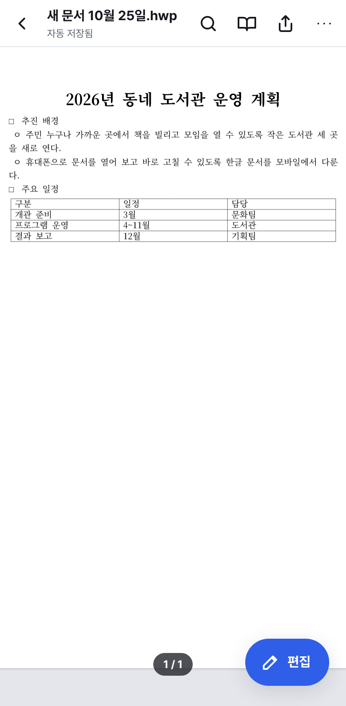

# Pocket HWP

**휴대폰에서 바로 여는 한글 문서** — 안드로이드·iOS용 오픈소스 HWP/HWPX 뷰어·편집기

Pocket HWP는 메일이나 메신저로 받은 한글(HWP·HWPX) 문서를 휴대폰과 태블릿에서 열어 보고,
간단히 고치고, 다시 보낼 수 있는 앱입니다. 데스크톱용 [HOP](https://github.com/golbin/hop)처럼
[rhwp](https://github.com/edwardkim/rhwp) 문서 엔진 위에 얇은 앱을 씌운 구조이고,
화면과 조작은 처음부터 **손가락과 작은 화면**에 맞춰 새로 만들었습니다.

| 최근 문서 | 쪽 보기 | 두 번 탭: 본문 폭 맞춤 | 편집 | 글자·문단 모양 | 읽기 모드 |
| --- | --- | --- | --- | --- | --- |
|  |  |  |  |  |  |

## 할 수 있는 일

**보기**

- HWP 5.0 · HWPX 문서 열기 (표·그림·수식·머리말/꼬리말 포함, rhwp 렌더링)
- 쪽을 위아래로 이어 보는 연속 스크롤, 화면 근처 쪽만 그리는 지연 렌더링
- 두 손가락 확대/축소, **두 번 탭하면 여백을 걷어낸 본문 폭 맞춤** ↔ 쪽 전체 보기
- **읽기 모드**: A4 쪽 대신 글을 휴대폰 폭에 맞춰 다시 흘려 보여 줌 (글자 크기·종이/세피아/밤 배경)
- 화면 한 번 탭으로 상·하단 바 숨기기, 쪽 썸네일 모아 보기, 문서 찾기
- 다크 모드, 안드로이드 뒤로 버튼 지원

**편집**

- 탭해서 캐럿 놓기, 길게 눌러 낱말 선택, 손잡이로 범위 조절, 잘라내기·복사·붙여넣기 메뉴
- 한글 조합 입력(Gboard·삼성 키보드·iOS 키보드)과 조합 중 미리보기
- 키보드 바로 위에 붙는 서식 도구: 굵게·기울임·밑줄·취소선, 글자 크기, 정렬
- 글자 색·형광펜·정렬·줄 간격 시트, 표·사진·오늘 날짜·기호 넣기
- 표 셀 안 편집, 찾아 바꾸기, 실행 취소/다시 실행
- 블루투스 키보드 단축키(⌘/Ctrl+Z·B·I·U·F·S, 화살표·Shift 선택)

**저장과 보내기**

- 앱 보관함에 **자동 저장** (편집할 때마다 잠시 뒤 저장, 앱이 백그라운드로 가면 바로 저장)
- 보내기: HWP · HWPX(실험적) · PDF · 텍스트 — 공유 시트로 메신저·메일·드라이브·“파일에 저장”
- 다른 앱의 “Pocket HWP로 열기”(안드로이드·iOS), 안드로이드 공유 시트로 받기
- 웹 앱(PWA)으로도 설치 가능, 한 번 연 뒤에는 오프라인 동작

## HOP와 무엇이 다른가요?

| | HOP | Pocket HWP |
| --- | --- | --- |
| 대상 | macOS · Windows · Linux | Android · iOS (+ 모바일 웹/PWA) |
| 앱 셸 | Tauri 2 (Rust) | Capacitor 8 (네이티브 WebView) |
| 문서 엔진 | rhwp (submodule) | rhwp (`@rhwp/core` npm 패키지) |
| 편집 UI | rhwp-studio (데스크톱 메뉴·툴바) | 모바일 전용 UI (터치 제스처·키보드 위 도구·바텀 시트) |
| 파일 모델 | 원본 파일에 저장 | 앱 보관함 + 자동 저장, 공유 시트로 내보내기 |

휴대폰에서는 받은 파일의 원래 자리에 다시 쓸 수 없는 경우가 많아서(메신저 첨부, 클라우드 파일 등)
문서를 앱 안에 두고 자동 저장한 뒤, 필요할 때 공유 시트로 보내는 방식을 씁니다.

## 설치·실행

### 바로 써 보기 (웹)

```sh
pnpm install
pnpm dev          # 같은 Wi-Fi의 휴대폰 브라우저에서 http://<컴퓨터 IP>:5173 접속
```

웹 배포(GitHub Pages)는 지금 보류 중입니다. 쓰려면 저장소 설정에서 Pages 소스를 “GitHub Actions”로 켠 뒤
Actions 탭에서 “웹 버전 배포” 워크플로를 직접 실행하세요(무료 요금제는 Public 저장소만 가능).

### 안드로이드

Android Studio(또는 Android SDK + JDK 21)가 필요합니다.

```sh
pnpm install
pnpm android      # 웹 빌드 → cap sync → Android Studio 열기
```

GitHub Actions의 **CI → 안드로이드 APK** 작업 결과물(`pocket-hwp-debug-apk`)로 디버그 APK를 바로 받을 수도 있습니다.

### iOS

macOS + Xcode가 필요합니다.

```sh
pnpm install
pnpm ios          # 웹 빌드 → cap sync → Xcode 열기
```

자세한 개발 정보는 [개발 문서](docs/DEVELOPMENT.md)를 보세요.

## 알려진 한계

- 한컴 전용 글꼴은 무료 글꼴(Pretendard · Noto Serif KR · 나눔)로 대신 보여 줘서 줄바꿈이 원본과 조금 다를 수 있습니다.
- 암호가 걸린 문서, 배포용 문서 편집, 변경 내용 추적은 아직 지원하지 않습니다.
- 편집한 문서는 HWP 5.0으로 보관합니다. HWPX로 보내기는 rhwp의 HWPX 저장이 안정화될 때까지 실험 기능입니다.
- PDF는 쪽을 그림으로 묶어 만듭니다(글자 선택·검색 불가).
- 편집은 본문·표 셀 텍스트 중심입니다. 도형·글상자·머리말 편집, 표 줄/칸 추가 등은 이후 과제입니다.

## Credits

- 문서 파싱·렌더링·편집 엔진: [rhwp](https://github.com/edwardkim/rhwp) (MIT) — 엔진을 공개해 주신 분들께 감사드립니다.
- 앱 구조와 번들 글꼴 구성은 [HOP](https://github.com/golbin/hop) (MIT)를 참고했습니다.
- 번들 글꼴: SIL Open Font License 1.1 — [public/fonts/OFL.md](public/fonts/OFL.md)

“한글”, “한컴”, “HWP”, “HWPX”는 ㈜한글과컴퓨터의 상표입니다.
Pocket HWP는 한글과컴퓨터와 제휴·후원·승인 관계가 없는 독립 오픈소스 프로젝트입니다.

License: [MIT](LICENSE)
