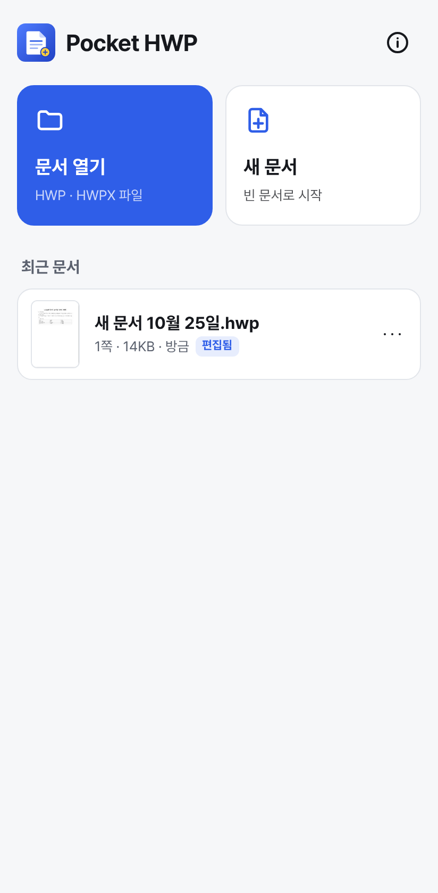
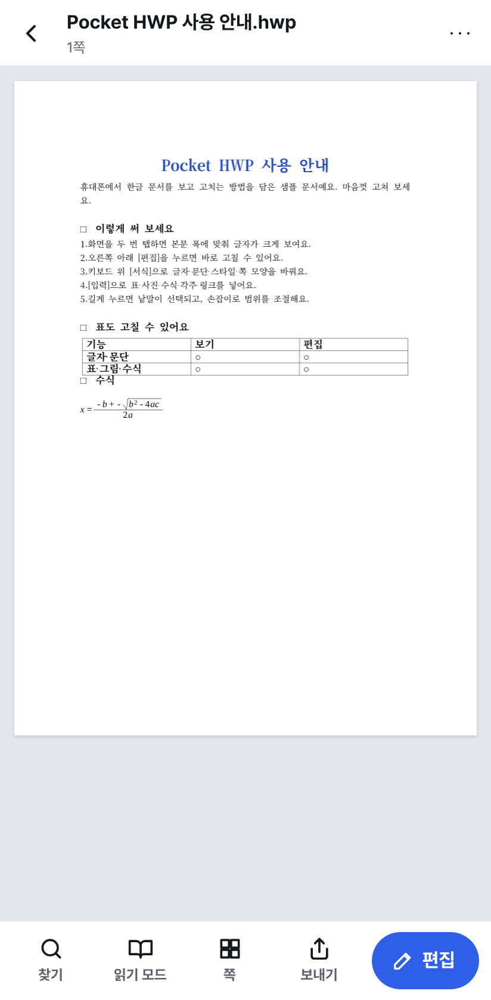
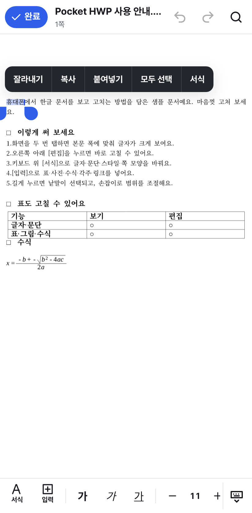
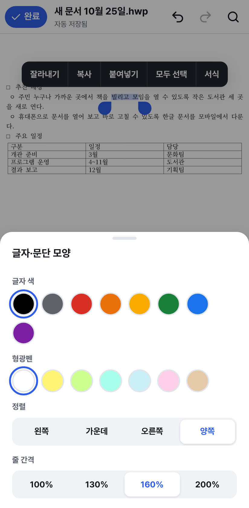
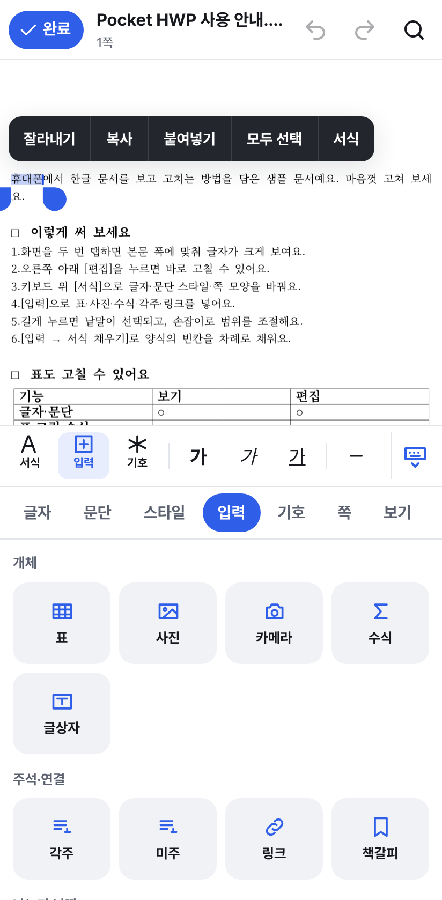
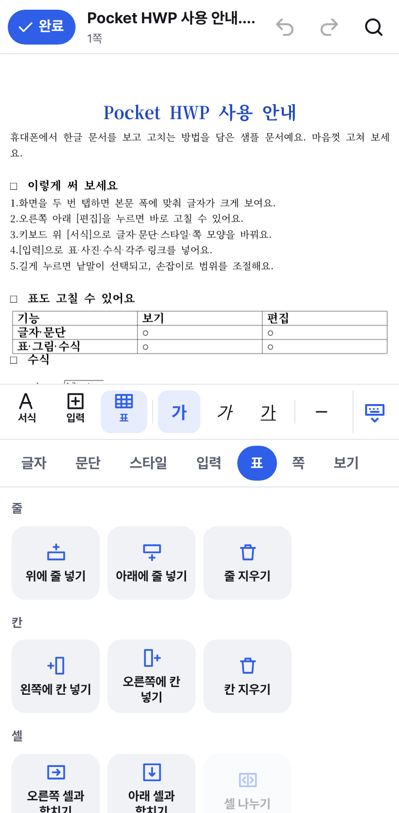
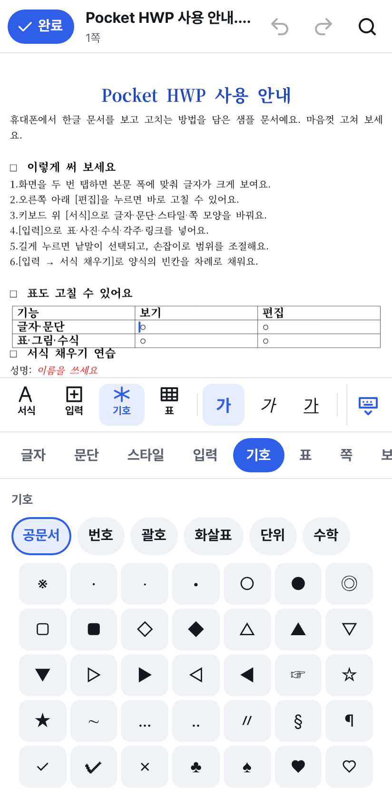
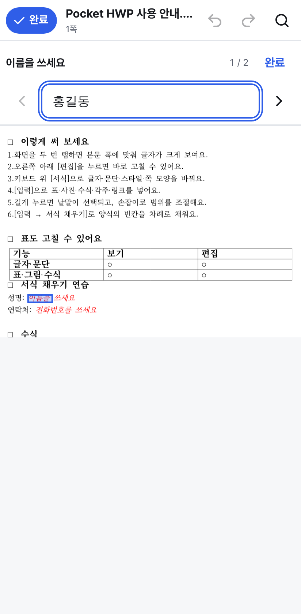
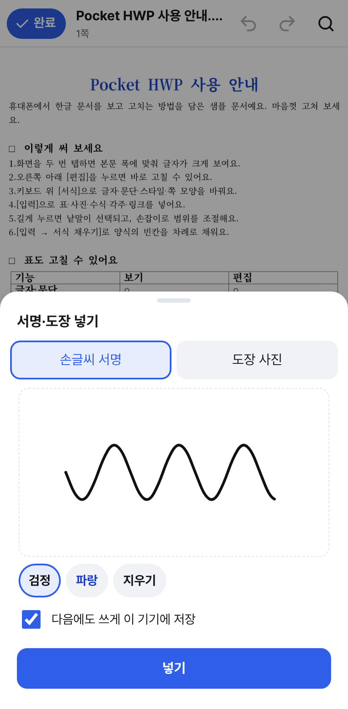
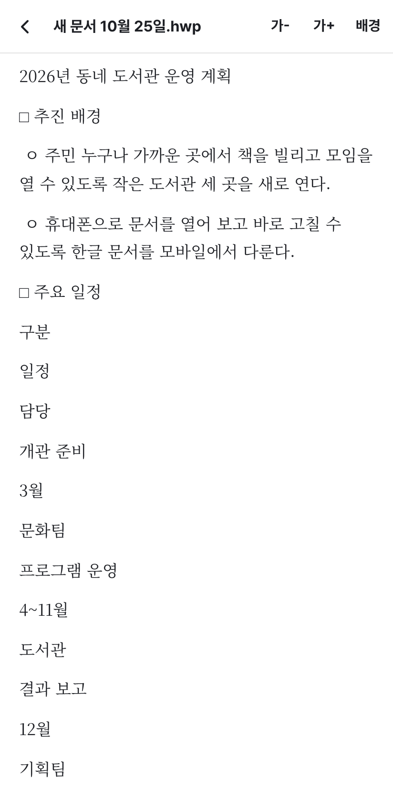

# Pocket HWP

**휴대폰에서 바로 여는 한글 문서** — 안드로이드·iOS용 오픈소스 HWP/HWPX 뷰어·편집기

Pocket HWP는 메일이나 메신저로 받은 한글(HWP·HWPX) 문서를 휴대폰과 태블릿에서 열어 보고,
간단히 고치고, 다시 보낼 수 있는 앱입니다. 데스크톱용 [HOP](https://github.com/golbin/hop)처럼
[rhwp](https://github.com/edwardkim/rhwp) 문서 엔진 위에 얇은 앱을 씌운 구조이고,
화면과 조작은 처음부터 **손가락과 작은 화면**에 맞춰 새로 만들었습니다.

> **베타 버전이에요.** 문서 엔진(rhwp)이 아직 1.0 전이라 복잡한 문서는 모양이 원본과 조금 다르거나,
> 저장할 때 일부 내용이 빠질 수 있어요(빠질 내용이 있으면 저장 전에 알려 줘요). 중요한 문서는 원본을 따로 두고 써 주세요.
> 문제를 발견하면 [이슈](https://github.com/shun1403/pocket-hwp/issues)로 알려 주세요. 개인정보는 [PRIVACY.md](PRIVACY.md)를 보세요.

## 바로 받기

| 안드로이드 | 아이폰 · 컴퓨터 |
| --- | --- |
| **[⬇ APK 내려받기 (v0.1.2)](https://github.com/shun1403/pocket-hwp/releases/download/v0.1.2/PocketHWP-0.1.2.apk)**<br>새 버전은 [릴리스 페이지](https://github.com/shun1403/pocket-hwp/releases)에서 | **[웹 앱 열기](https://shun1403.github.io/pocket-hwp/)** → 홈 화면에 추가<br>설치 파일 없이 브라우저에서 바로 |

자세한 설치 방법은 [아래](#-휴대폰에-설치하기)에 있어요.

## 3분 만에 써 보기

1. 앱을 열고 **샘플 문서로 둘러보기**를 눌러요. 쓰는 법이 담긴 문서가 열려요.
2. 아래쪽 줄의 **편집**을 누르고 아무 데나 탭해서 글을 써 보세요. 고친 내용은 바로 자동 저장돼요.
3. 키보드 위 **서식**·**입력**을 눌러 글자 모양, 표, 사진을 바꾸거나 넣어 보세요.
4. 다 고쳤으면 **완료** → **보내기**로 카톡·메일에 한글 파일(.hwp)이나 PDF로 보내요.

받은 한글 파일은 카톡·메일·내 파일에서 파일을 누르고 **다른 앱으로 열기 → Pocket HWP**를 고르면 바로 열려요(안드로이드 앱).

| 처음 화면 | 보기 | 편집 | 서식 패널 | 입력 패널 |
| --- | --- | --- | --- | --- |
|  |  |  |  |  |
| **표 패널** | **기호·상용구** | **서식 채우기** | **서명·도장** | **읽기 모드·읽어 주기** |
|  |  |  |  |  |

## 📱 휴대폰에 설치하기

PC 없이 휴대폰만으로 설치할 수 있어요. 아래 중 편한 방법을 고르세요.

| 방법 | 안드로이드 | 아이폰 | 비용 | 특징 |
| --- | :---: | :---: | --- | --- |
| [1. 웹 앱 (홈 화면에 추가)](#1-웹-앱--안드로이드아이폰-모두) | ✅ | ✅ | 무료 | 설치 파일 없이 주소만 열면 됨, 자동 업데이트 |
| [2. APK 설치 파일](#2-apk-설치-파일--안드로이드) | ✅ | – | 무료 | 진짜 앱, “다른 앱으로 열기”·공유 받기 지원 |
| [3. Xcode로 직접 설치](#3-xcode로-직접-설치--아이폰-mac-필요) | – | ✅ | 무료 (Mac 필요) | 진짜 앱, 7일마다 다시 설치 |
| 앱스토어 · 플레이스토어 | 준비 중 | 준비 중 | – | – |

> **문서는 휴대폰 안에만 저장돼요.** 서버로 보내지 않아요. 앱(또는 브라우저 데이터)을 지우면 문서도 함께 지워지니,
> 중요한 문서는 **보내기**로 파일을 따로 저장하거나, 처음 화면 오른쪽 위 🛡 **보관함 관리 → 모두 백업하기**로 백업해 두세요.

### 1. 웹 앱 — 안드로이드·아이폰 모두

웹 주소: **https://shun1403.github.io/pocket-hwp/**

**안드로이드 (크롬)**
1. 크롬에서 위 주소를 열어요.
2. 오른쪽 위 **⋮** 메뉴 → **홈 화면에 추가**(또는 **앱 설치**) → **설치**를 눌러요.
3. 홈 화면에 생긴 **Pocket HWP** 아이콘으로 열어요.

**안드로이드 (삼성 인터넷)**
1. 삼성 인터넷에서 위 주소를 열어요.
2. 아래쪽 **≡** 메뉴 → **페이지 추가** → **홈 화면**을 눌러요.

**아이폰·아이패드 (사파리)**
1. **사파리**에서 위 주소를 열어요. (다른 브라우저보다 사파리가 가장 확실해요.)
2. 아래쪽 **공유 버튼(□↑)** → **홈 화면에 추가** → **추가**를 눌러요.
3. 앞으로는 꼭 **홈 화면의 아이콘으로** 열어 주세요.
   - 사파리 탭에서 쓰면 오래 쓰지 않을 때 사파리가 문서를 지울 수 있어요. 홈 화면 앱은 괜찮아요.
   - 사파리 탭과 홈 화면 앱은 보관함이 따로예요. 탭에서 고친 문서는 **보관함 관리 → 모두 백업하기** 후 홈 화면 앱에서 **백업에서 불러오기**로 옮겨요.

웹 앱에서 문서 열기: 앱의 **문서 열기**를 누르면 휴대폰의 파일 앱(내 파일·파일·드라이브 등)이 열려요.
카카오톡·메일로 받은 파일은 먼저 휴대폰에 저장한 뒤 열어 주세요.

### 2. APK 설치 파일 — 안드로이드

1. 휴대폰 브라우저에서 이 저장소의 **[Releases](https://github.com/shun1403/pocket-hwp/releases)** 페이지를 열어요.
2. 맨 위 릴리스의 **Assets**에서 `PocketHWP-버전.apk`를 눌러 내려받아요. (지금은 `PocketHWP-0.1.2.apk`)
3. 다운로드가 끝나면 알림이나 **내 파일 → 다운로드**에서 APK를 눌러요.
4. “출처를 알 수 없는 앱” 안내가 뜨면 **설정 → 이 출처 허용**을 켜고 뒤로 돌아와 **설치**를 눌러요.
   - 삼성 휴대폰: **설정 → 애플리케이션 → 특별한 접근 → 출처를 알 수 없는 앱 설치**에서 브라우저(또는 내 파일)를 허용해요.
5. “Play 프로텍트” 경고가 뜨면 **세부정보 → 무시하고 설치**를 눌러요. 플레이스토어를 거치지 않은 앱이라 뜨는 안내예요.
6. 설치가 끝나면 앱 서랍의 **Pocket HWP**로 열어요.

설치한 뒤에는 카카오톡·메일·내 파일에서 한글 파일을 누르고 **다른 앱으로 열기 → Pocket HWP**를 고르거나,
**공유 → Pocket HWP**로 보내면 바로 열려요.

**업데이트:** 새 릴리스의 APK를 같은 방법으로 설치하면 문서는 그대로 두고 앱만 새 버전으로 바뀌어요.
(같은 서명 키로 만든 릴리스끼리만 업데이트돼요. 아래 “개발 빌드”와는 서로 업데이트되지 않아요.)

**새 버전 알림 받기:** GitHub 계정이 있으면 저장소 위쪽 **Watch → Custom → Releases**를 켜 두세요. 새 버전이 나오면 알려 줘요.
앱이 스스로 업데이트하지는 않으니, 가끔 릴리스 페이지를 확인해 주세요.

**개발 빌드에서 릴리스로 옮길 때:** 서명이 달라서 덮어 설치가 안 돼요. 먼저 앱에서 🛡 **보관함 관리 → 모두 백업하기**로
백업 파일을 만들고, 개발 빌드를 지운 뒤 릴리스를 설치해서 **백업에서 불러오기**로 문서를 되돌려요.


### 3. Xcode로 직접 설치 — 아이폰 (Mac 필요)

앱스토어에 올라가기 전까지, 아이폰에 “진짜 앱”으로 설치하려면 Mac이 필요해요.
무료 Apple ID로도 내 아이폰에 설치할 수 있어요.

1. Mac에 **Xcode**(App Store에서 무료)와 **Node.js 22**, **pnpm**을 설치해요.
2. 터미널에서 실행해요:
   ```sh
   git clone https://github.com/shun1403/pocket-hwp.git
   cd pocket-hwp
   pnpm install
   pnpm ios
   ```
3. Xcode가 열리면 왼쪽 **App** → **Signing & Capabilities**에서
   - **Team**: 내 Apple ID(Personal Team)를 고르고,
   - **Bundle Identifier**: `com.내이름.pockethwp`처럼 나만의 이름으로 바꿔요.
4. 아이폰을 케이블로 연결하고, 아이폰 **설정 → 개인정보 보호 및 보안 → 개발자 모드**를 켜요 (iOS 16 이상).
5. Xcode 위쪽 기기 목록에서 내 아이폰을 고르고 **▶ (Run)** 을 눌러요.
6. 처음 열 때 막히면 아이폰 **설정 → 일반 → VPN 및 기기 관리**에서 내 Apple ID를 **신뢰**해요.

무료 Apple ID로 설치한 앱은 **7일 뒤 열리지 않아요.** 그때 다시 5번을 하면 돼요(문서는 그대로 남아요).
유료 Apple Developer 계정이 있으면 TestFlight로 Mac 없이 나눠 줄 수 있어요.

## 쓰는 법은 세 가지만 기억하면 돼요

1. **보기**: 문서를 열면 아래 줄에 `찾기 · 읽기 모드 · 쪽 · 보내기 · 편집`이 있어요. 두 번 탭하면 글자가 크게 보여요.
2. **편집**: `편집`을 누르면 키보드 위에 빠른 도구 줄이 붙어요. 굵게·크기·정렬·글머리표는 여기서 바로 바꿔요.
3. **서식·입력·기호**: 빠른 도구 줄의 `서식`·`입력`·`기호`를 누르면 키보드 자리에 한글 메뉴처럼 나뉜 도구 패널이 올라와요.
   문서를 탭하면 다시 키보드로 돌아가요.

처음 편집할 때 짧은 사용법이 한 번 나와요. 다시 보려면 문서의 `더보기 → 사용법`을 누르세요.

## 할 수 있는 일

**보기**

- HWP 5.0 · HWPX 문서 열기 (표·그림·수식·머리말/꼬리말 포함, rhwp 렌더링), **암호 문서 열기**
- 연속 스크롤, 두 손가락 확대/축소, **두 번 탭: 본문 폭 맞춤** ↔ 쪽 전체
- **읽기 모드**: 글을 휴대폰 폭에 맞춰 다시 흘려 보여 줌 (글자 크기·종이/세피아/밤 배경)
- **읽어 주기**: 읽기 모드에서 문서를 소리 내어 읽어 줌 (빠르기 0.8~1.5배, 읽는 문단 강조, 문단을 눌러 거기서부터)
- 찾기, 쪽 모아 보기, 화면 한 번 탭으로 도구 숨기기, 다크 모드, 안드로이드 뒤로 버튼

**편집 — 도구 패널 (한글 메뉴 구성)**

| 탭 | 들어 있는 기능 |
| --- | --- |
| 글자 | 굵게·기울임·밑줄·취소선·위/아래 첨자, 크기, 글자 색, 형광펜, 글꼴(함초롬바탕·맑은 고딕 등), 자간·장평, 글자 모양 지우기 |
| 문단 | 정렬 5종(배분 포함), 줄 간격, 글머리표, 문단 번호(**공문서 1. 가. 1) 가)** 등), 수준 올리기/내리기, 왼쪽 여백·첫 줄 들여/내어쓰기, 문단 위·아래 간격 |
| 스타일 | 바탕글·본문·개요 1~7 등 문서의 문단 스타일, **지금 모양으로 새 스타일 만들기·스타일 고치기·이름 바꾸기** |
| 입력 | 표, 사진·카메라, 수식(미리보기·예시 포함), 글상자, **도형(사각형·타원·선)**, 각주·미주, 링크(**열기·고치기·지우기**), **책갈피 목록·이동·이름 바꾸기**, **메모(한글과 호환: 넣기·읽기·고치기·지우기)**, 쪽/단 나누기, 날짜·시각, **서식 채우기**, **서명·도장** |
| 기호 | 공문서 기호(※ ○ □ ▶ 등)·원문자(① ㉮ ㉠)·괄호·화살표·단위·수학 기호, 최근에 쓴 기호, **상용구**(자주 쓰는 문구 저장) |
| 표 | 줄·칸 넣기/지우기, 셀 합치기/나누기, **여러 칸 골라 합치기·칠하기·글 지우기**, **칸 너비·줄 높이**, **테두리(실선·굵게·점선·없음, 바깥만)**, **계산식(합계·평균·직접 입력)**, **표 나누기·붙이기**, 셀 배경색, 표 지우기 (표 안에 캐럿이 있을 때만 보임) |
| 쪽 | 용지(A4·A3·A5·B4·B5·Letter·Legal·신국판), 세로/가로, 여백, **편집 용지(F7): 용지 크기·여백 일곱 가지를 mm로, 제본(한쪽·맞쪽·위로), 문서 전체/지금 구역**, 다단, 머리말·꼬리말(**여러 줄·정렬**), **쪽 번호**(1 · - 1 - · 1 / 5 · 1쪽), **쪽 테두리·배경** |
| 보기 | 찾기·바꾸기, 읽기 모드, **목차(개요 제목으로 이동)**, 책갈피, 메모 목록, 조판 부호·투명 선 보기, 글자 수 세기, 문서 정보 |

**편집 — 손가락 조작**

- 탭해서 캐럿 놓기, **캐럿 손잡이를 끌어 정확한 자리로 옮기기**
- 길게 눌러 낱말 선택 → 손잡이로 범위 조절 → 잘라내기·복사·붙여넣기·서식 메뉴
- **그림·수식·도형·차트를 탭해서 선택** → 크게/작게, 글자처럼/글 둘레 배치, 수식 고치기, 삭제
- 도형: 선·채우기 색, 겹친 순서(맨 앞·앞으로·뒤로·맨 뒤), 다른 도형과 묶기·풀기, 캡션 달기
- 차트: 값을 표로 보고 고치기
- **머리말·꼬리말·각주를 누르면** 여러 줄 입력창으로 바로 고치기 (각주 지우기 포함)
- 보기 모드에서 **링크를 누르면** 열기 (웹·메일 주소만, 열기 전에 확인)
- **서식 있는 붙여넣기**: 웹 페이지 등에서 복사한 글을 굵게·표 같은 모양째 붙이기
- 한글 조합 입력(**조합 중인 글도 실제 글꼴·크기·자간·줄 간격 그대로** 문서에 보이고 밑줄로 표시), 표 셀 안 편집, 실행 취소/다시 실행
- **키보드 단축키**: 블루투스 키보드·컴퓨터에서 한글과 같은 조합(Ctrl+B 진하게, Ctrl+Shift+C 가운데 정렬, Alt+Shift+N·W 자간, Alt+Shift+J·K 장평, Alt+Shift+Z·A 줄 간격, Alt+L 글자 모양, Alt+T 문단 모양, F6 스타일, F7 편집 용지, Ctrl+Enter 쪽 나누기, Ctrl+C·X·V 등). 한글 입력 상태에서도 돼요. 목록은 `F1` 또는 `더보기 → 단축키`

**양식 채우기**

- **서식 채우기**: 신청서·공문 양식의 빈칸(누름틀)을 큰 입력칸 하나로 차례로 채워요. 키보드의 `다음`으로 넘어가요.
  누름틀이 없는 양식은 표의 빈 칸을 왼쪽 칸 이름(성명·주소 등)과 함께 차례로 돌아요.
  누름틀이 있는 문서를 열면 `빈칸 N개 채우기` 버튼이 떠요.
- **서명·도장**: 손가락으로 서명하거나, 흰 종이에 찍은 도장을 사진으로 찍으면 바탕을 지워 넣어요. 저장해 두고 다음에 한 번에 넣을 수 있어요(이 기기 안에만 저장).

**저장과 보내기**

- 앱 보관함에 **자동 저장** (암호 문서는 보관본도 같은 암호로 저장)
- **원래 파일에 저장**: 앱의 `문서 열기`로 연 파일은 고친 내용을 그 파일 자리에 다시 쓸 수 있어요
  (안드로이드·아이폰 앱, 컴퓨터의 크롬·엣지). 편집 화면 위의 저장 버튼이나 `보내기 → 원래 파일에 저장`
- **버전 기록**: 편집하는 동안 10분마다, 그리고 닫을 때 버전을 남겨요. `더보기 → 버전 기록`에서 처음 연 상태나 예전 내용으로 되돌리거나 사본으로 열어요
- 최근 문서: **맨 위에 고정**, **사본 만들기**(양식 다시 쓰기), 이름 바꾸기, 이름으로 찾기
- 보내기: HWP · **암호 건 HWP** · HWPX(실험적) · PDF · 텍스트 — 공유 시트로 메신저·메일·드라이브·“파일에 저장”
- **인쇄**: 안드로이드·아이폰 인쇄 화면, 컴퓨터 브라우저 인쇄 창
- 다른 앱의 “Pocket HWP로 열기”(안드로이드·iOS), 안드로이드 공유 시트로 받기
- 처음 쓰는 사람을 위한 **샘플 문서**

## 자주 묻는 질문

**문서는 어디에 저장돼요? 서버로 올라가나요?**
휴대폰 안(앱 보관함)에만 저장돼요. 이 앱에는 서버가 없어서 문서를 어디에도 보내지 않아요.
휴대폰의 구글·iCloud 백업을 켜 두었다면 다른 앱 데이터처럼 백업에 함께 들어가요. 자세한 내용은 [개인정보 안내](PRIVACY.md)를 보세요.

**폰을 바꾸면 문서는 어떻게 옮겨요?**
구글·iCloud 백업이 켜져 있으면 대부분 따라와요. 확실하게 옮기려면 처음 화면 🛡 **보관함 관리 → 모두 백업하기**로
백업 파일을 만들어 새 폰으로 옮긴 뒤 **백업에서 불러오기**를 하세요.

**고친 문서를 원래 파일에 저장할 수 있나요?**
앱의 **문서 열기**로 연 파일은 **보내기 → 원래 파일에 저장**으로 그 자리에 덮어쓸 수 있어요.
카톡·메일에서 "다른 앱으로 열기"로 받은 파일은 원래 자리에 쓸 권한이 없어서, **보내기**로 새로 저장해요.

**.hwp와 .hwpx는 뭐가 달라요?**
둘 다 한글 문서예요. .hwp는 예전부터 쓰던 형식이라 어디서나 잘 열리고, .hwpx는 새 형식이에요(한글 2014 이후).
보통은 .hwp로 보내면 되고, **메모를 넣은 문서는 메모가 남도록 .hwpx로 보내세요.**

**PC 한글에서 열면 모양이 조금 달라요.**
한컴 전용 글꼴이 휴대폰에 없어서 비슷한 무료 글꼴로 보여 주기 때문이에요. 파일 안의 글꼴 정보는 그대로라,
PC 한글에서 열면 원래 글꼴로 보여요. 저장하면서 빠지는 내용이 있으면 저장하기 전에 알려 줘요.

**문제를 발견했어요.**
[이슈](https://github.com/shun1403/pocket-hwp/issues)로 알려 주세요. 화면 캡처와 함께, 가능하면 개인 정보가 없는 문서로 다시 해 본 결과를 적어 주시면 빨리 고칠 수 있어요.
보안 문제는 공개 이슈 대신 [보안 정책](SECURITY.md)을 따라 알려 주세요.

## HOP와 무엇이 다른가요?

| | HOP | Pocket HWP |
| --- | --- | --- |
| 대상 | macOS · Windows · Linux | Android · iOS (+ 모바일 웹/PWA) |
| 앱 셸 | Tauri 2 (Rust) | Capacitor 8 (네이티브 WebView) |
| 문서 엔진 | rhwp (submodule) | rhwp (`@rhwp/core` npm 패키지) |
| 편집 UI | rhwp-studio (데스크톱 메뉴·툴바) | 모바일 전용 UI (터치 제스처·키보드 위 도구·바텀 시트) |
| 파일 모델 | 원본 파일에 저장 | 앱 보관함 + 자동 저장·버전 기록, 원래 파일에 저장 또는 공유 시트로 내보내기 |

휴대폰에서는 받은 파일의 원래 자리에 다시 쓸 수 없는 경우가 많아서(메신저 첨부, 클라우드 파일 등)
문서를 앱 안에 두고 자동 저장합니다. 앱의 `문서 열기`로 연 파일은 원래 자리에 다시 저장할 수 있고,
그 밖의 파일은 공유 시트로 보냅니다.

## 직접 빌드하기 (개발자)

```sh
pnpm install
pnpm dev          # 같은 Wi-Fi의 휴대폰 브라우저에서 http://<컴퓨터 IP>:5173 접속
pnpm android      # 웹 빌드 → Android Studio 열기 (Android SDK + JDK 21 필요)
pnpm ios          # 웹 빌드 → Xcode 열기 (macOS + Xcode 필요)
```

릴리스 만들기, 서명 키, 구조와 설계는 [개발 문서](docs/DEVELOPMENT.md)를 보세요.

## 알려진 한계

- 한컴 전용 글꼴은 무료 글꼴(Pretendard · Noto Serif KR · 나눔)로 대신 보여 줘서 줄바꿈이 원본과 조금 다를 수 있습니다.
- 변경 내용 추적, 맞춤법 검사, 한자 변환은 아직 지원하지 않습니다. 배포용 문서는 보기만 합니다.
- 메모는 HWPX 형식에만 담깁니다. 메모가 있는 문서는 HWPX(.hwpx)로 저장하고, .hwp로 보내면 메모가 빠진다고 먼저 알려 줍니다.
  한글(.hwp) 파일에 원래 있던 메모는 자리만 보이고 내용은 읽을 수 없습니다. 메모를 넣거나 고치면 그 전 편집은 실행 취소로 되돌릴 수 없습니다.
- 편집 용지의 "위로" 제본은 파일에는 그대로 저장되지만, 앱 화면에서는 한쪽 제본처럼 보입니다(엔진 그리기 한계). "새 구역으로" 적용은 엔진이 구역을 나누지 못해 넣지 않았습니다.
- 캡션은 문서 엔진이 아직 도형·글상자에만 달 수 있습니다(그림·표 캡션은 엔진 지원 대기).
- 차트 값 고치기는 한글에서 만든 차트(HWP용 사본이 함께 들어 있는 차트)만 됩니다. 엔진이 고칠 수 없는 차트는 이유를 알려 주고 바꾸지 않습니다.
- 쪽 번호를 넣으면 꼬리말에 있던 글은 쪽 번호로 바뀝니다.
- 다른 앱에서 "Pocket HWP로 열기"·공유로 받은 파일은 원래 자리에 다시 쓸 권한이 없어서, 보내기로 저장합니다.
- 읽어 주기는 기기의 음성 엔진을 씁니다. 한국어 음성이 없는 기기에서는 설정에서 음성을 내려받아야 합니다.
- 각주·미주는 본문 위에서 캐럿으로 직접 고치지 않고, 눌러서 여는 입력창에서 고칩니다.
- 편집한 문서는 HWP 5.0으로 보관합니다(메모가 있는 문서만 HWPX). HWPX로 보내기는 rhwp의 HWPX 저장이 안정화될 때까지 실험 기능입니다.
- 실제 기기 확인은 안드로이드 위주로 했고, 아이폰 앱은 빌드만 확인했습니다. 아이폰에서는 웹 앱을 권장합니다.
- PDF는 쪽을 그림으로 묶어 만듭니다(글자 선택·검색 불가).

## Credits

- 문서 파싱·렌더링·편집 엔진: [rhwp](https://github.com/edwardkim/rhwp) (MIT) — 엔진을 공개해 주신 분들께 감사드립니다.
- 앱 구조와 번들 글꼴 구성은 [HOP](https://github.com/golbin/hop) (MIT)를 참고했습니다.
- 번들 글꼴: SIL Open Font License 1.1 — [public/fonts/OFL.md](public/fonts/OFL.md)

## Notice

본 제품은 한글과컴퓨터의 한글 문서 파일(.hwp) 공개 문서를 참고하여 개발하였습니다.

HWPX 문서는 국가 표준 개방형 문서 형식(OWPML, KS X 6101)을 따릅니다.
한글과컴퓨터의 프로그램 코드나 글꼴은 들어 있지 않으며, 배포용 문서의 보호를 푸는 기능은 넣지 않았습니다.

## Trademark

“한글”, “한컴”, “HWP”, “HWPX”는 주식회사 한글과컴퓨터의 등록 상표입니다.
Pocket HWP는 한글과컴퓨터와 제휴·후원·승인 관계가 없는 독립 오픈소스 프로젝트이며,
이 이름들은 앱이 다루는 파일 형식을 설명하기 위해서만 씁니다.

“Hangul”, “Hancom”, “HWP”, and “HWPX” are registered trademarks of Hancom Inc.
Pocket HWP is an independent open-source project with no affiliation, sponsorship, or endorsement by Hancom Inc.

## License

[MIT](LICENSE)
